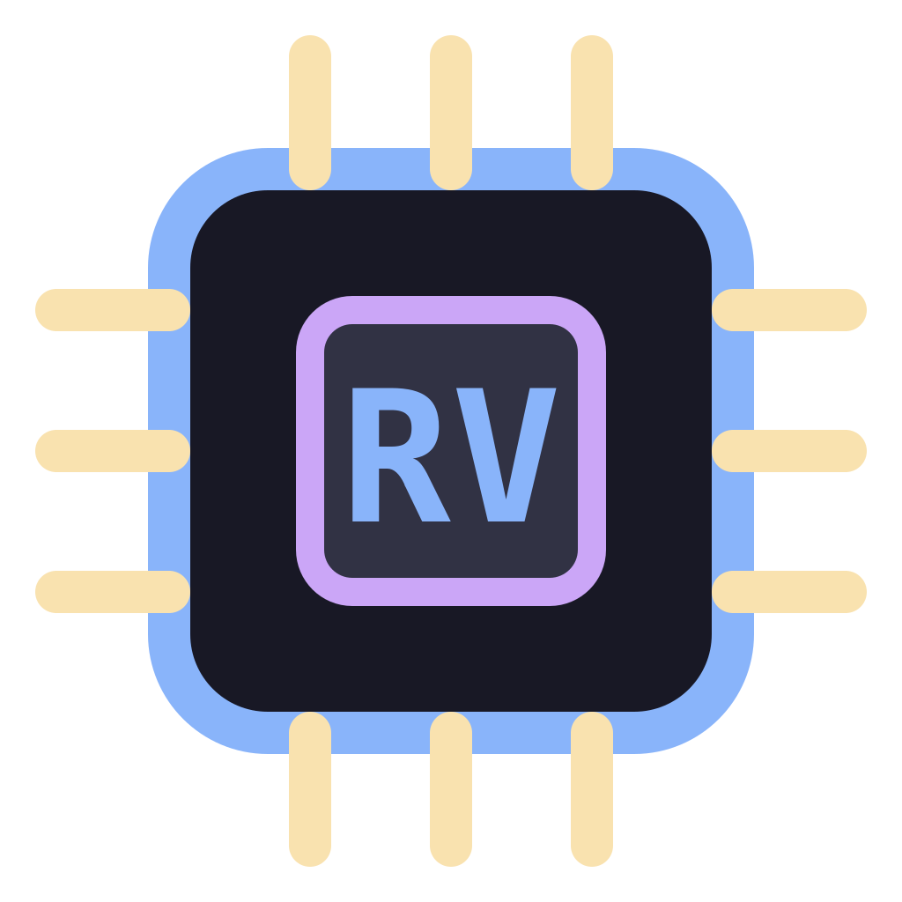
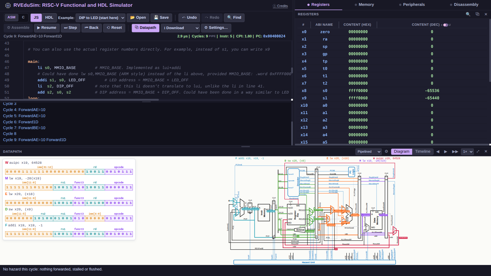
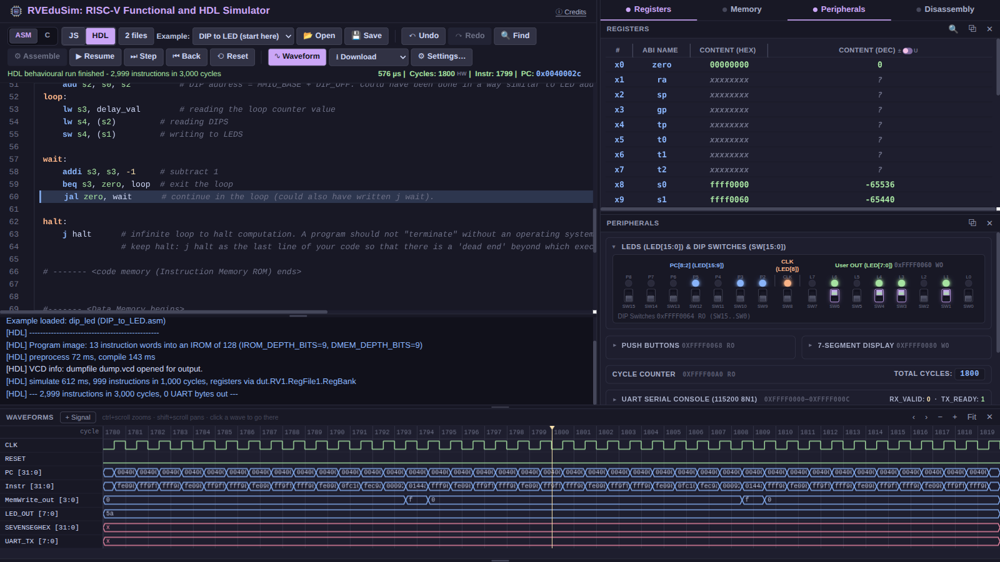

<div align="center">



# RVEduSim

**A RISC-V simulator for learning computer architecture, from assembly down to your own Verilog processor.**
Write RV32I(M) assembly or C, watch it run on a single-cycle, multi-cycle or pipelined model, then run the same program on the processor you designed, on a simulated FPGA board.
Runs in the browser with nothing to install, or as a desktop app on Windows, macOS and Linux with fast native Verilog simulation.

[](https://github.com/r-panicker/RVEduSim/actions/workflows/pages.yml)
[](https://github.com/r-panicker/RVEduSim/actions/workflows/desktop.yml)
[](https://github.com/r-panicker/RVEduSim/releases)

**[Open in the browser](https://r-panicker.github.io/RVEduSim/)** · [Download the desktop app](https://github.com/r-panicker/RVEduSim/releases/latest) · [User guide](riscv_simulator.md) · [Specification](riscv_simulator_specs.md)



</div>

## Why RVEduSim

| | |
|---|---|
| **One program, two engines** | Run a program on a fast JavaScript model of the processor, or on your own Verilog design, with the same breakpoints, stepping and board. |
| **See inside the processor** | Single-cycle, multi-cycle and 5-stage pipelined models, with an animated datapath, a pipeline timeline, hazard and forwarding detail, and configurable branch prediction. |
| **Step forward and back** | By instruction, by C statement or pseudo-instruction, or by clock cycle in the pipeline. Stepping back restores registers, memory and peripherals. |
| **Test your Verilog** | Simulate your processor with Icarus Verilog, see every signal in the waveform viewer, check the netlist Yosys synthesises from it, and cross-check it against the JavaScript model to find the first instruction where they disagree. |
| **A board on screen** | A Nexys 4 / Nexys A7 with a Pmod OLED: LEDs, switches, buttons, 7-segment display, UART, OLED and accelerometer, all memory-mapped as on the real board. |
| **Ready for Vivado** | Export `.mem` images and the generated testbench, so the program and inputs you simulated go straight onto the FPGA. |



## Get it

### Desktop app
Download the installer for your OS from [Releases](https://github.com/r-panicker/RVEduSim/releases):

| OS | File |
|---|---|
| Windows | `RVEduSim-<version>-win-x64.exe` |
| macOS | `RVEduSim-<version>-mac-arm64.dmg` (Apple Silicon) or `RVEduSim-<version>-mac-x64.dmg` (Intel) |
| Linux | `RVEduSim-<version>-linux-x86_64.AppImage` |

The builds are not code-signed yet, so the first launch needs one extra step:

| OS | First launch |
|---|---|
| Windows | On the SmartScreen warning, click **More info → Run anyway**. |
| macOS | Open the `.dmg` and drag RVEduSim to Applications. Open it once and dismiss the warning, then go to **System Settings → Privacy & Security** and click **Open Anyway**. |
| Linux | `chmod +x RVEduSim-*.AppImage`, then run it. |

Verilator compiles your design to C++, so it needs a C++ compiler: `g++` on Linux, the Xcode command line tools on macOS. Where there is none, the app downloads one (Zig) the first time.

### Browser
Nothing to install: **https://r-panicker.github.io/RVEduSim/** always runs the latest code on `main`. To run a copy yourself, build the page from `src/` (Node.js 20 or later) and serve `dist/`:

```bash
npm install && npm run build
python3 -m http.server 8000 -d dist     # then open http://localhost:8000/
```

Opened straight from disk, only the built-in example works: browsers block the files the other examples and the Verilog engines load over `file://`.

### Browser or desktop?
Both run the same simulator. The desktop app runs the Verilog tools natively instead of as WebAssembly, which matters once your processor runs real programs:

| | Browser | Desktop |
|---|---|---|
| Install | none | installer |
| Icarus Verilog | WebAssembly | native, faster |
| Verilator | no | yes: compiles your design and simulates it 20 to 100 times faster than Icarus |
| Speed of a long run | about 8,000 cycles a second | hundreds of thousands to millions a second with Verilator |

## For CG3207

RVEduSim was written for [CG3207](https://nus-cg3207.github.io/), the computer architecture course at the National University of Singapore. The course site documents the board's [peripherals](https://nus-cg3207.github.io/rv_resources/peripherals/) and the [Verilog templates](https://github.com/NUS-CG3207/nus-cg3207.github.io/tree/main/docs/code_templates/Asst_02) that HDL mode expects: a Wrapper module that connects the processor to the board, and the processor's own modules.

## Build from source

The simulator is one HTML file with no build step; `examples/` and `vendor/` sit beside it. The desktop app is in `electron/`, and [electron/README.md](electron/README.md) explains how to build Icarus Verilog and Verilator for it and package installers.

```bash
cd electron
npm install
npm run build:iverilog && npm run build:verilator
npm start
```

### Tests

```bash
cd riscv_simulator_tests
npm install
npm test
```

Each suite is a Node script that loads the page in jsdom and can be run on its own. The suites that need a processor's RTL skip themselves unless `RVSIM_CORE_DIR` names a folder holding `RV.v`, its modules and `Wrapper.v` (see `core_dir.js`). The native engine, Verilator and app suites run on the prebuilt core in `examples/hdl/` without one; they need the desktop app's builds.

## Licence

MIT, for everything in this repository except the third-party components listed in [THIRD_PARTY_NOTICES.md](THIRD_PARTY_NOTICES.md), which keep their own licences.
